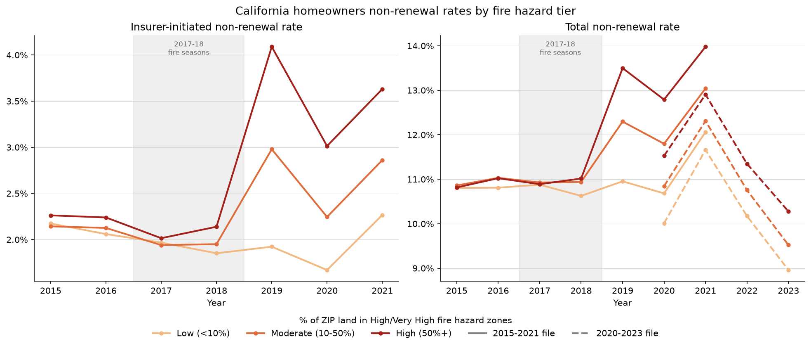
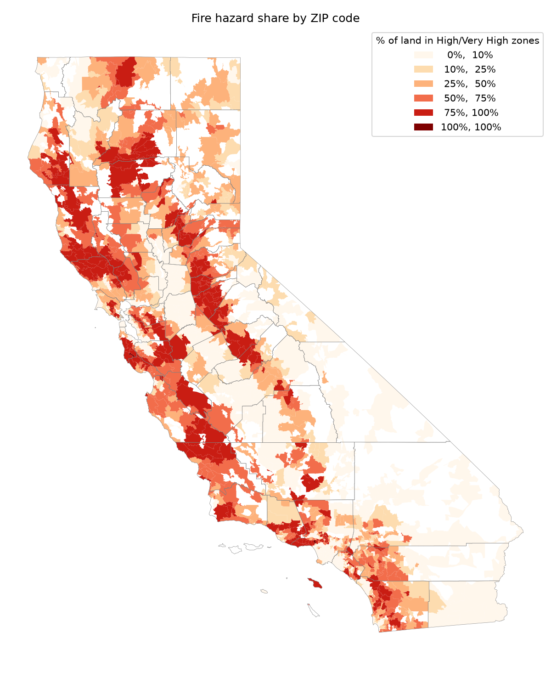
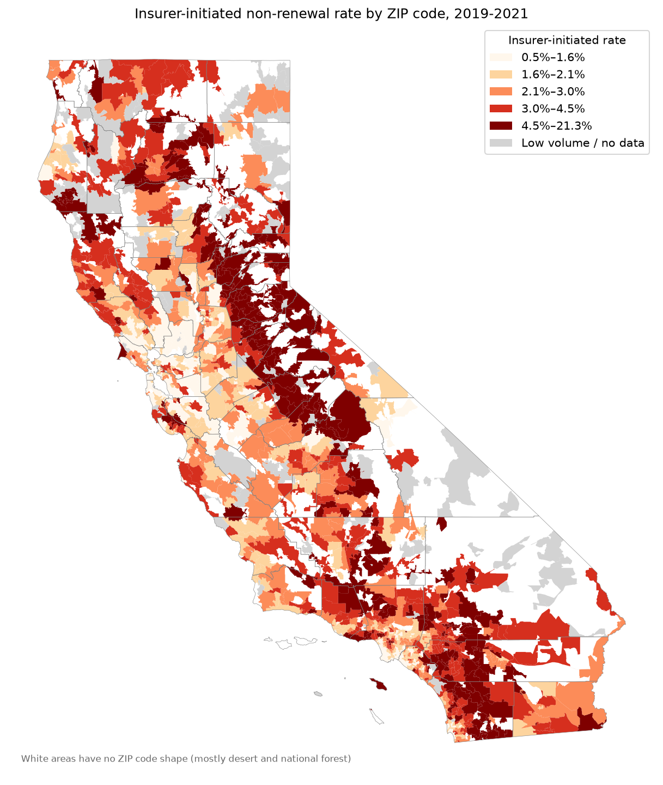
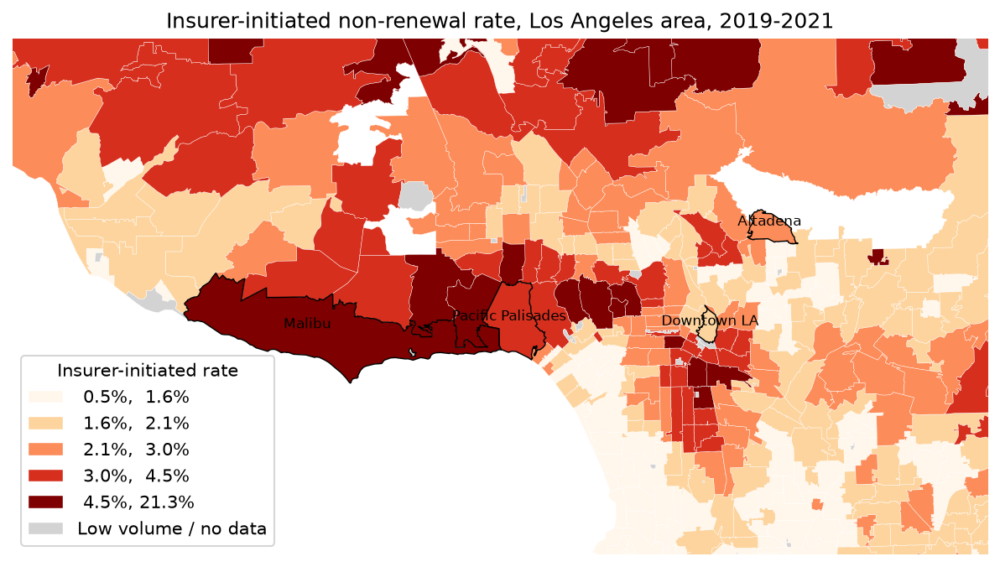

# California Wildfire Hazard and Home Insurance Non-Renewals: Python and GIS

This project looks at whether insurers in California are dropping homeowners more often in places with a higher wildfire hazard. I combined the California Department of Insurance's ZIP-level non-renewal counts with CAL FIRE's Fire Hazard Severity Zones, measured each ZIP code's share of high-hazard land with GIS in Python, and compared non-renewal rates across hazard levels from 2015 to 2023.

[View the interactive map](https://shaneghim.github.io/wildfirenonrenewals/images/wildfire_map.html)

**Data**

I retrieved the [CDI residential policy counts by ZIP code](https://www.insurance.ca.gov/01-consumers/200-wrr/DataAnalysisOnWildfiresAndInsurance.cfm), which contained new, renewed, and non-renewed homeowners policies in the voluntary market, in two separate files (2015 to 2021 and 2020 to 2023). For the fire hazard zones, I used CAL FIRE's [Fire Hazard Severity Zones](https://osfm.fire.ca.gov/what-we-do/community-wildfire-preparedness-and-mitigation/fire-hazard-severity-zones), which come as State Responsibility Area (SRA) maps (effective April 2024) and Local Responsibility Area (LRA) maps (March 2025). To map the ZIP codes, I used the [Census 2020 cartographic boundary files](https://www.census.gov/geographies/mapping-files/time-series/geo/cartographic-boundary.html) for ZIP Code Tabulation Areas and counties.

<ins>Terminology</ins>

Hazard share: the percentage of a ZIP code's land in High or Very High Fire Hazard Severity Zones.

Non-renewal rate: non-renewed policies divided by policies up for renewal (renewed + non-renewed). The insurer-initiated rate counts only policies the insurer chose not to renew.

**Method**

<ins>Insurance data</ins>

The two CDI files didn't agree for 2020 and 2021, the years they overlap (only 10% to 20% of rows matched), so I kept them as separate series instead of combining them. The 2015 to 2021 file is the main one, since it separates insurer-initiated non-renewals. I dropped 25 out-of-state rows and flagged ZIP-years with fewer than 100 policies up for renewal as low volume.

<ins>GIS</ins>

I reprojected every layer (converted map coordinates from one coordinate system to another) to California Albers (EPSG:3310), combined the SRA and LRA hazard zones, repaired invalid shapes, and dissolved them by class. Intersecting the zones with 1,802 ZIP code shapes gave each ZIP code's hazard share, which I capped at 100% to remove rounding error. 1,798 of those ZIP codes have CDI data. The 859 CDI ZIP codes with no shape held only 0.03% of policies, so I left them out.

<ins>Analysis</ins>

I grouped ZIP codes into Low (under 10%), Moderate (10% to 50%), and High (50% and over) hazard tiers, based on the spread of hazard shares. Each tier's insurer-initiated rate comes from summed counts, compared before and after insurers responded to the 2017 and 2018 fires (2015 to 2018 vs. 2019 to 2021). Insurers decide at renewal, so the 2017 and 2018 fires first show up in 2019.

**Maps**

 

The darkest non-renewal areas line up with the highest hazard areas, along the Sierra foothills and the Southern California mountains. Grey ZIP codes had fewer than 300 policies up for renewal from 2019 to 2021, and white areas have no ZIP code shape (mostly desert and national forest).

I included an LA close-up since it covers the 2025 Palisades and Eaton fire areas.

**Results**

| Hazard tier | ZIP codes | Share of policies | Insurer rate, 2015 to 2018 | Insurer rate, 2019 to 2021 | Change |
|------------|-----------:|-----------:|-----------:|-----------:|-----------:|
| Low (under 10%) | 827 | 49.2% | 2.01% | 1.96% | -0.05 pts |
| Moderate (10% to 50%) | 426 | 25.3% | 2.04% | 2.69% | +0.65 pts |
| High (50% and over) | 545 | 25.5% | 2.16% | 3.58% | +1.42 pts |

**Findings**

About a quarter of policies up for renewal were in High-tier ZIP codes. From 2015 to 2018, every tier had an insurer-initiated rate of around 2%. After the 2017 and 2018 fire seasons, the gap opened: in 2019, High-tier ZIP codes were dropped at 4.1%, over twice the Low tier's 1.9%. The 2020 to 2023 file only has total non-renewals, but the High tier's total rate stayed highest through 2023.

A one-year drop in the middle of a rising trend suggests something outside the data interrupted it. The 2020 dip lines up with California's first mandatory moratorium on non-renewals, which protected more than 1 million homes near the 2019 fires from December 2019 to December 2020 ([CDI](https://www.insurance.ca.gov/01-consumers/140-catastrophes/wildfirenonrenewalinfo.cfm)). The Low tier dipped too, but only by 0.25 points compared to the High tier's 1.08, so most of the drop was where the moratorium applied. A larger moratorium followed in November 2020 ([CalMatters](https://calmatters.org/environment/wildfires/2020/11/california-homeowners-fire-insurance-dropped-again/)), but High-tier rates still rose in 2021, so the moratoriums likely slowed the trend rather than reversed it.

In the areas hit by the 2025 Los Angeles fires, Malibu (6.5%) and Pacific Palisades (3.8%) were well above the 2.6% statewide rate before the 2025 fires, while Altadena (2.3%) was slightly below it, so non-renewals didn't flag every community that later burned.

**Files**

- `notebooks/`: run in order, 1 through 5
  - `1_cdi_nonrenewals.ipynb`: loads and compares the two CDI files, calculates non-renewal rates
  - `2_zip_boundaries.ipynb`: loads Census ZIP code and county boundaries, keeps California, reprojects
  - `3_firehazard_overlay.ipynb`: combines the hazard zones and calculates each ZIP code's hazard share
  - `4_nonrenewals_byhazard.ipynb`: assigns hazard tiers, calculates rates by tier and year, makes the main chart
  - `5_maps.ipynb`: makes the static maps and the interactive map
- `clean/`: cleaned CSV outputs
- `images/`: the chart and static maps
- `wildfire_map.html`: the interactive map
- `README.md`: this page

<ins>To rerun it</ins>

1.  Create a `raw/` folder next to `clean/`. Download the two CDI Excel files, the SRA and LRA hazard zone files, and the Census 2020 ZCTA and county files (500k) from the links above into it, and unzip the hazard zone files.
2.  Create a Python 3.13 environment and install the packages: `uv venv --python 3.13`, then `uv pip install pandas geopandas matplotlib folium mapclassify openpyxl ipykernel`.
3.  Run the notebooks in order, 1 through 5. Notebook 2 saves the ZIP code and county boundary files the later notebooks need, and notebook 3 takes a few minutes because of the statewide overlay.

**Limitations**

Hazard share measures land, not homes; Downtown LA scores 52% because of Elysian Park, where no one lives. The 2024 and 2025 hazard maps are applied back to 2015, where they rate only the land itself. The data covers only the voluntary market, so it shows who was dropped, not where they found coverage, and the tiers show an association, not a cause.

**What's next**

I could add FAIR Plan policy counts by ZIP code to see where dropped homeowners ended up, and add the U.S. Treasury's ZIP-level premium data (2018 to 2022) to see whether prices in high-hazard areas kept up with losses.
